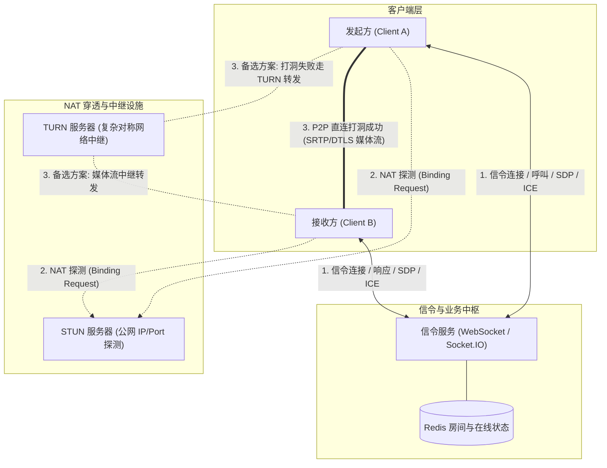
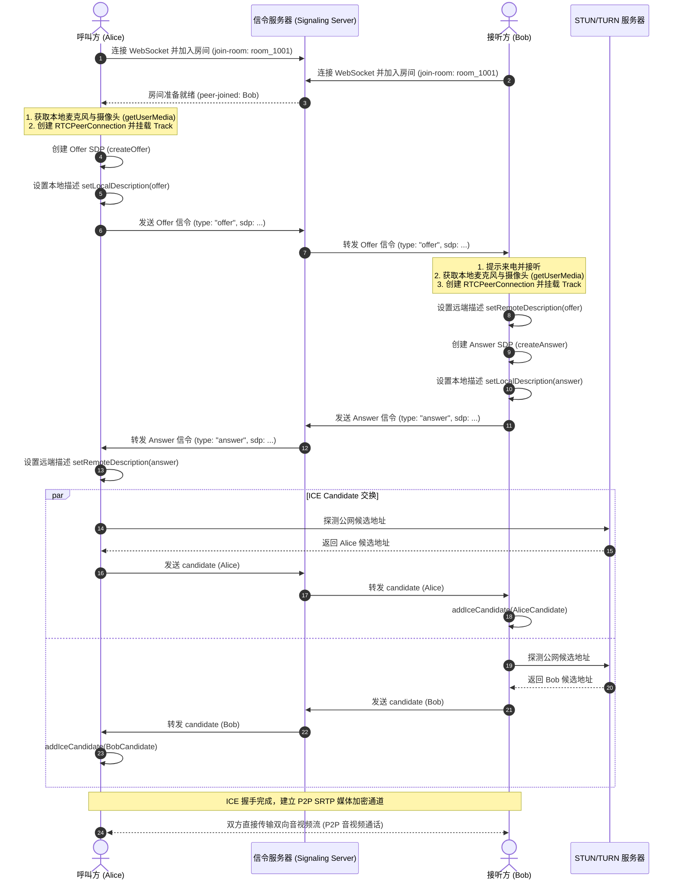
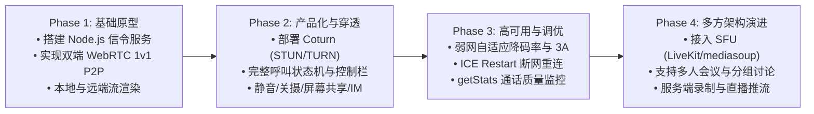

# 视频聊天软件设计与实施方案 (Live Chat)

本文档提供了一套完整、现代且可落地的**端到端实时音视频聊天系统设计方案**。核心聚焦于人和人之间（1v1）高质量、低延迟的音视频通话，同时兼顾架构扩展性（未来平滑升级到多人会议）。

---

## 目录
1. [方案概述与设计原则](#1-方案概述与设计原则)
2. [技术选型](#2-技术选型)
3. [系统整体架构设计](#3-系统整体架构设计)
4. [核心业务与信令交互流程](#4-核心业务与信令交互流程)
5. [信令协议设计规范](#5-信令协议设计规范)
6. [关键模块实现原型](#6-关键模块实现原型)
   - [6.1 信令服务端实现 (Node.js)](#61-信令服务端实现-nodejs)
   - [6.2 前端音视频与信令客户端实现 (TypeScript)](#62-前端音视频与信令客户端实现-typescript)
7. [网络穿透与 NAT 方案 (STUN / TURN)](#7-网络穿透与-nat-方案-stun--turn)
8. [核心难点与工程优化实践](#8-核心难点与工程优化实践)
9. [项目实施路径与演进路线](#9-项目实施路径与演进路线)

---

## 1. 方案概述与设计原则

### 1.1 核心功能需求
- **1v1 实时视频与音频通话**：超低端到端延迟（< 300ms）。
- **设备控制**：麦克风静音/解静音、摄像头开启/关闭、前后置摄像头切换、扬声器/输出设备选择。
- **辅助功能**：屏幕共享 (Screen Share)、通话中文字消息/即时通讯 (DataChannel / IM)、通话时长统计。
- **连接管理**：呼叫邀请、接听/拒绝、挂断、异常断网重连、通话状态感知。

### 1.2 关键设计原则
1. **轻量与标准化**：媒体流采用浏览器标准 WebRTC 规范，免安装插件；信令流采用全双工 WebSocket。
2. **媒体与信令分离**：信令服务器仅负责房间调度、会话协商（SDP）与候选地址交换（ICE Candidate），不承载音视频媒体数据流，最大化降低服务器带宽成本。
3. **高打洞率与可用性**：P2P 优先建立连接（省流量、低延迟）；在对称型 NAT 等复杂网络环境下自动降级走 TURN 中继，确保 100% 连通率。
4. **渐进式扩展**：从 1v1 Mesh/P2P 架构起步，预留 SFU（Selective Forwarding Unit）媒体服务器接口，以便后续扩展多人会议。

---

## 2. 技术选型

| 模块分层 | 推荐技术栈 | 备选方案 | 选型理由 |
| :--- | :--- | :--- | :--- |
| **客户端 (Web)** | Vue 3 / React + TypeScript + Web API (WebRTC) | 原生 JS / Flutter Web | 现代组件化开发，生态丰富；WebRTC API 原生支持。 |
| **客户端 (移动端/桌面端)** | Flutter / React Native / Electron | 原生 iOS (Swift) / Android (Kotlin) | 跨端复用代码，开发周期短；如追求极限性能可选原生 WebRTC SDK。 |
| **信令服务 (Signaling)** | Node.js + Socket.IO / ws 或 Go + Gorilla WebSocket | Python FastAPI + WebSockets | 异步高并发 I/O 表现优异，事件驱动模型极其适合信令状态机维护。 |
| **NAT 穿透 / 中继** | coturn (开源 STUN/TURN 服务器) | 商业云服务 (Twilio / Agora / 阿里云 RTC) | 自建成本低、完全可控、支持 RFC 5766 TURN 规范。 |
| **媒体扩展 (进阶)** | LiveKit / mediasoup (SFU 架构) | Janus Gateway / Pion | 若后续升级多方会议，Node/Go 生态良好，易维护。 |
| **持久化与缓存** | Redis (房间状态、用户在线状态) + PostgreSQL / MySQL | MongoDB | Redis 读写速度快，支持 Pub/Sub 机制，方便信令集群水平扩容。 |

---

## 3. 系统整体架构设计

在 1v1 通话场景下，采用 **P2P (Peer-to-Peer)** 架构结合 **STUN/TURN** 辅助穿透：



### 架构各组件职责：
- **Signaling Server（信令服务器）**：
  - 维持双向心跳连接，负责房间生命周期管理、用户呼叫信令分发、Offer/Answer SDP 转发以及 ICE Candidate 路由。
- **STUN Server（Session Traversal Utilities for NAT）**：
  - 帮助客户端发现自身的公网映射 IP 与端口（NAT 穿透探测）。
- **TURN Server（Traversal Using Relays around NAT）**：
  - 当双端处于对称型 NAT 或严格防火墙后无法直接 P2P 打洞时，充当媒体流中继转发节点。
- **WebRTC DataChannel / Media Stream**：
  - 双端直连通道。音频采用 Opus 编码（高保真、低比特率自适应），视频采用 VP8 / VP9 / H.264 / AV1 编码。

---

## 4. 核心业务与信令交互流程

### 4.1 1v1 呼叫建立完整时序图



---

## 5. 信令协议设计规范

所有信令采用 JSON 格式承载，通过 WebSocket 传输。

### 5.1 加入房间 (`join-room`)
- **客户端 -> 服务端**
```json
{
  "type": "join-room",
  "payload": {
    "roomId": "room-8888",
    "userId": "user-alice",
    "metadata": {
      "username": "Alice",
      "avatar": "https://example.com/avatar1.png"
    }
  }
}
```

### 5.2 房间用户就绪通知 (`peer-joined`)
- **服务端 -> 客户端**
```json
{
  "type": "peer-joined",
  "payload": {
    "peerId": "user-bob",
    "isInitiator": true
  }
}
```

### 5.3 交换 SDP (`offer` / `answer`)
- **客户端 -> 服务端 -> 接收端**
```json
{
  "type": "offer",
  "payload": {
    "roomId": "room-8888",
    "targetUserId": "user-bob",
    "sdp": {
      "type": "offer",
      "sdp": "v=0\r\no=- 20518 2 IN IP4 0.0.0.0\r\ns=-\r\nt=0 0\r\na=group:BUNDLE 0 1\r\n..."
    }
  }
}
```

### 5.4 交换网络候选地址 (`ice-candidate`)
- **客户端 -> 服务端 -> 接收端**
```json
{
  "type": "ice-candidate",
  "payload": {
    "roomId": "room-8888",
    "targetUserId": "user-bob",
    "candidate": {
      "candidate": "candidate:842163049 1 udp 1677729535 192.168.1.100 54123 typ srflx raddr 192.168.1.100 rport 54123 generation 0",
      "sdpMid": "0",
      "sdpMLineIndex": 0
    }
  }
}
```

### 5.5 通话控制（挂断/拒绝/忙线）
```json
{
  "type": "call-action",
  "payload": {
    "roomId": "room-8888",
    "action": "hangup", // 枚举: "reject" | "hangup" | "busy" | "cancel"
    "reason": "User clicked hangup button"
  }
}
```

---

## 6. 关键模块实现原型

### 6.1 信令服务端实现 (Node.js)

以下为一个具备完整房间管理、转发能力的信令服务器示例：

```javascript
// server.js
const http = require('http');
const express = require('express');
const { Server } = require('socket.io');

const app = express();
const server = http.createServer(app);
const io = new Server(server, {
  cors: {
    origin: '*',
    methods: ['GET', 'POST']
  }
});

// 房间状态映射：roomId -> Set of socketId
const rooms = new Map();

io.on('connection', (socket) => {
  console.log(`[Socket] 客户端已连接: ${socket.id}`);

  // 加入房间
  socket.on('join-room', ({ roomId, userId }) => {
    socket.join(roomId);
    socket.data.userId = userId;
    socket.data.roomId = roomId;

    if (!rooms.has(roomId)) {
      rooms.set(roomId, new Set());
    }

    const roomMembers = rooms.get(roomId);

    if (roomMembers.size >= 2) {
      socket.emit('room-full', { roomId });
      return;
    }

    roomMembers.add(socket.id);
    console.log(`[Room ${roomId}] 用户 ${userId} (${socket.id}) 加入. 当前成员数: ${roomMembers.size}`);

    // 通知已经在房间内的成员有新成员加入 (作为发起方)
    socket.to(roomId).emit('peer-joined', {
      peerSocketId: socket.id,
      userId: userId,
      isInitiator: true
    });
  });

  // 转发 WebRTC Offer
  socket.on('offer', ({ targetSocketId, sdp }) => {
    io.to(targetSocketId).emit('offer', {
      senderSocketId: socket.id,
      sdp
    });
  });

  // 转发 WebRTC Answer
  socket.on('answer', ({ targetSocketId, sdp }) => {
    io.to(targetSocketId).emit('answer', {
      senderSocketId: socket.id,
      sdp
    });
  });

  // 转发 ICE Candidate
  socket.on('ice-candidate', ({ targetSocketId, candidate }) => {
    io.to(targetSocketId).emit('ice-candidate', {
      senderSocketId: socket.id,
      candidate
    });
  });

  // 处理主动离开或挂断
  socket.on('hangup', ({ roomId }) => {
    socket.to(roomId).emit('peer-left', { socketId: socket.id });
  });

  // 处理断开连接
  socket.on('disconnect', () => {
    const { roomId } = socket.data;
    if (roomId && rooms.has(roomId)) {
      const roomMembers = rooms.get(roomId);
      roomMembers.delete(socket.id);
      if (roomMembers.size === 0) {
        rooms.delete(roomId);
      } else {
        socket.to(roomId).emit('peer-left', { socketId: socket.id });
      }
    }
    console.log(`[Socket] 客户端断开连接: ${socket.id}`);
  });
});

const PORT = process.env.PORT || 3000;
server.listen(PORT, () => {
  console.log(`信令服务器运行在 http://localhost:${PORT}`);
});
```

---

### 6.2 前端音视频与信令客户端实现 (TypeScript)

封装一个标准易复用的 `WebRTCClient` 类，管理媒体流、PeerConnection 与信令事件：

```typescript
// WebRTCClient.ts
import { io, Socket } from 'socket.io-client';

export interface RTCClientCallbacks {
  onLocalStream?: (stream: MediaStream) => void;
  onRemoteStream?: (stream: MediaStream) => void;
  onCallEnded?: () => void;
  onError?: (err: Error) => void;
}

export class WebRTCClient {
  private socket: Socket;
  private pc: RTCPeerConnection | null = null;
  private localStream: MediaStream | null = null;
  private remoteStream: MediaStream | null = null;
  private targetSocketId: string | null = null;
  private callbacks: RTCClientCallbacks;

  // ICE 服务器配置
  private rtcConfig: RTCConfiguration = {
    iceServers: [
      { urls: 'stun:stun.l.google.com:19302' },
      {
        urls: 'turn:your-turn-server.com:3478',
        username: 'turnuser',
        credential: 'turnpassword'
      }
    ],
    iceCandidatePoolSize: 10
  };

  constructor(serverUrl: string, callbacks: RTCClientCallbacks) {
    this.callbacks = callbacks;
    this.socket = io(serverUrl);
    this.initSocketEvents();
  }

  // 1. 初始化本地媒体
  public async initLocalMedia(video = true, audio = true): Promise<MediaStream> {
    try {
      this.localStream = await navigator.mediaDevices.getUserMedia({
        video: video ? { width: { ideal: 1280 }, height: { ideal: 720 }, frameRate: { ideal: 30 } } : false,
        audio: audio ? { echoCancellation: true, noiseSuppression: true, autoGainControl: true } : false
      });
      this.callbacks.onLocalStream?.(this.localStream);
      return this.localStream;
    } catch (error) {
      this.callbacks.onError?.(new Error(`无法获取媒体设备: ${(error as Error).message}`));
      throw error;
    }
  }

  // 2. 加入指定房间
  public joinRoom(roomId: string, userId: string) {
    this.socket.emit('join-room', { roomId, userId });
  }

  // 3. 监听信令服务器事件
  private initSocketEvents() {
    // 远端新用户加入，当前端作为 Initiator 发起 Offer
    this.socket.on('peer-joined', async ({ peerSocketId }) => {
      this.targetSocketId = peerSocketId;
      await this.createPeerConnection();
      const offer = await this.pc!.createOffer();
      await this.pc!.setLocalDescription(offer);
      this.socket.emit('offer', { targetSocketId: peerSocketId, sdp: offer });
    });

    // 收到对端的 Offer
    this.socket.on('offer', async ({ senderSocketId, sdp }) => {
      this.targetSocketId = senderSocketId;
      await this.createPeerConnection();
      await this.pc!.setRemoteDescription(new RTCSessionDescription(sdp));
      const answer = await this.pc!.createAnswer();
      await this.pc!.setLocalDescription(answer);
      this.socket.emit('answer', { targetSocketId: senderSocketId, sdp: answer });
    });

    // 收到对端的 Answer
    this.socket.on('answer', async ({ sdp }) => {
      if (this.pc) {
        await this.pc.setRemoteDescription(new RTCSessionDescription(sdp));
      }
    });

    // 收到对端的 ICE Candidate
    this.socket.on('ice-candidate', async ({ candidate }) => {
      if (this.pc && candidate) {
        try {
          await this.pc.addIceCandidate(new RTCIceCandidate(candidate));
        } catch (e) {
          console.error('添加 ICE 候选失败', e);
        }
      }
    });

    // 对端离开
    this.socket.on('peer-left', () => {
      this.hangup(false);
      this.callbacks.onCallEnded?.();
    });
  }

  // 4. 创建并配置 PeerConnection
  private async createPeerConnection() {
    if (this.pc) return;

    this.pc = new RTCPeerConnection(this.rtcConfig);
    this.remoteStream = new MediaStream();
    this.callbacks.onRemoteStream?.(this.remoteStream);

    // 将本地所有音视频轨道加入到 PeerConnection
    if (this.localStream) {
      this.localStream.getTracks().forEach((track) => {
        this.pc!.addTrack(track, this.localStream!);
      });
    }

    // 监听远端媒体轨道
    this.pc.ontrack = (event) => {
      event.streams[0].getTracks().forEach((track) => {
        this.remoteStream?.addTrack(track);
      });
    };

    // 监听本地 ICE Candidate 生成并通知对端
    this.pc.onicecandidate = (event) => {
      if (event.candidate && this.targetSocketId) {
        this.socket.emit('ice-candidate', {
          targetSocketId: this.targetSocketId,
          candidate: event.candidate
        });
      }
    };

    // 监听连接状态
    this.pc.onconnectionstatechange = () => {
      console.log(`[WebRTC 状态]: ${this.pc?.connectionState}`);
      if (this.pc?.connectionState === 'disconnected' || this.pc?.connectionState === 'failed') {
        this.hangup(false);
      }
    };
  }

  // 5. 控制功能：静音麦克风
  public toggleAudio(enabled: boolean) {
    if (this.localStream) {
      this.localStream.getAudioTracks().forEach((track) => (track.enabled = enabled));
    }
  }

  // 6. 控制功能：开关摄像头
  public toggleVideo(enabled: boolean) {
    if (this.localStream) {
      this.localStream.getVideoTracks().forEach((track) => (track.enabled = enabled));
    }
  }

  // 7. 挂断通话
  public hangup(notifyServer = true) {
    if (notifyServer && this.socket) {
      this.socket.emit('hangup', { roomId: this.socket.id });
    }

    if (this.pc) {
      this.pc.close();
      this.pc = null;
    }

    if (this.localStream) {
      this.localStream.getTracks().forEach((track) => track.stop());
      this.localStream = null;
    }

    this.targetSocketId = null;
  }
}
```

---

## 7. 网络穿透与 NAT 方案 (STUN / TURN)

P2P 通信成功的关键在于能否穿越各类 NAT 设备（圆锥型 NAT、限制型 NAT、对称型 NAT）。

### 7.1 Coturn 极简 Docker 私有化部署
在公网服务器（需开放 UDP/TCP 3478 以及中继 UDP 49152-65535）上部署 Coturn：

```bash
docker run -d --net=host \
  --name=coturn \
  coturn/coturn \
  -n \
  --log-file=stdout \
  --min-port=49152 \
  --max-port=65535 \
  --listening-port=3478 \
  --fingerprint \
  --lt-cred-mech \
  --realm=turn.yourdomain.com \
  --user=turnuser:turnpassword
```

### 7.2 动态凭据生成（安全进阶）
生产环境切勿使用静态密码，推荐开启 Coturn 的 `use-auth-secret`，结合时间戳与 HMAC-SHA1 算法由后端动态颁发有时效性（如 24 小时过期）的 TURN 临时凭据：
```
username = timestamp : userId
credential = Base64(HMAC-SHA1(username, shared_secret))
```

---

## 8. 核心难点与工程优化实践

### 8.1 浏览器自动播放限制 (Autoplay Policy)
- **痛点**：远端视频加载后直接调用 `video.play()` 会被 Chrome/Safari 拦截，报 `NotAllowedError`。
- **解决手段**：
  1. 挂载本地视频的 `<video>` 标签必须声明 `muted` 和 `playsinline`。
  2. 远端视频在用户点击“呼叫/接听”按钮（用户显式手势交互）后再触发 `play()`，若仍被拦截则提示用户“点击页面恢复音频播放”。

### 8.2 弱网对抗与自适应码率 (ABR)
- **自适应分辨率与帧率**：
  - 利用 WebRTC 内置的 Google Congestion Control (GCC) 算法进行实时带宽估计。
  - 使用 `RTCRtpSender.setParameters()` 动态降级帧率和最大码率：
    ```javascript
    const parameters = sender.getParameters();
    if (parameters.encodings.length > 0) {
      parameters.encodings[0].maxBitrate = 800000; // 限制至 800 kbps
      await sender.setParameters(parameters);
    }
    ```
- **丢包与抖动处理**：
  - 音频开启 In-band FEC（前向纠错）与 NACK（丢包重传）。
  - Opus 音频启用 DTX（不连续传输，静音时不发包节省带宽）。

### 8.3 回声消除与噪音抑制 (3A 算法)
- WebRTC 默认在 `getUserMedia` 中集成了 3A 引擎：
  - **AEC** (Acoustic Echo Cancellation - 回声消除)
  - **ANS** (Automatic Noise Suppression - 背景降噪)
  - **AGC** (Automatic Gain Control - 自动增益补偿)
- 配置规范：
  ```javascript
  {
    audio: {
      echoCancellation: true,
      noiseSuppression: true,
      autoGainControl: true,
      sampleRate: 48000,
      channelCount: 1
    }
  }
  ```

### 8.4 网络切换与 ICE 重连 (ICE Restart)
- 用户在 4G/5G 与 Wi-Fi 切换时，本地 IP 改变会导致通道断开。
- 监听 `pc.oniceconnectionstatechange`，当变为 `failed` 时触发 `pc.restartIce()`，重新执行一次 Offer-Answer 协商，无缝恢复通话。

---

## 9. 项目实施路径与演进路线



### 总结
本方案以 **WebRTC + WebSocket 信令 + Coturn 穿透** 为坚实基石，确保人在各种复杂网络环境下的端到端超低延迟视频通话体验；架构逻辑清晰、各层解耦，无论是快速构建 MVP 验证产品，还是后续长期演进为工业级通信软件均具备极高可行性。
